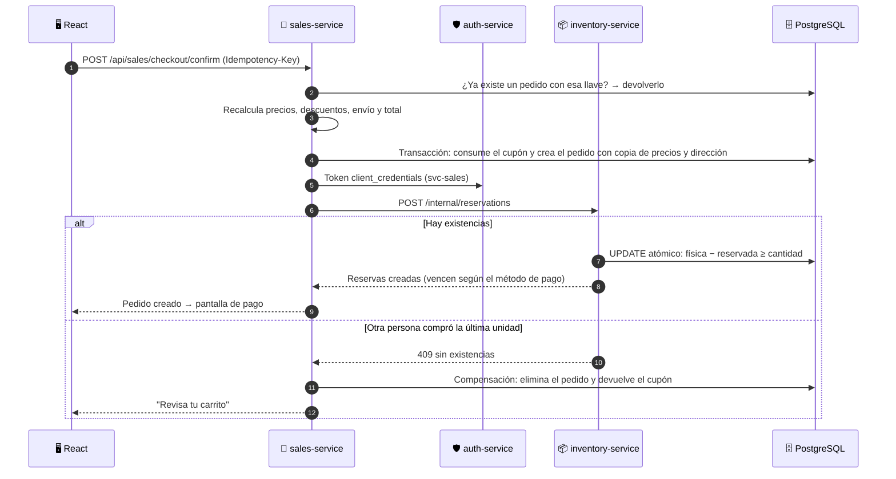
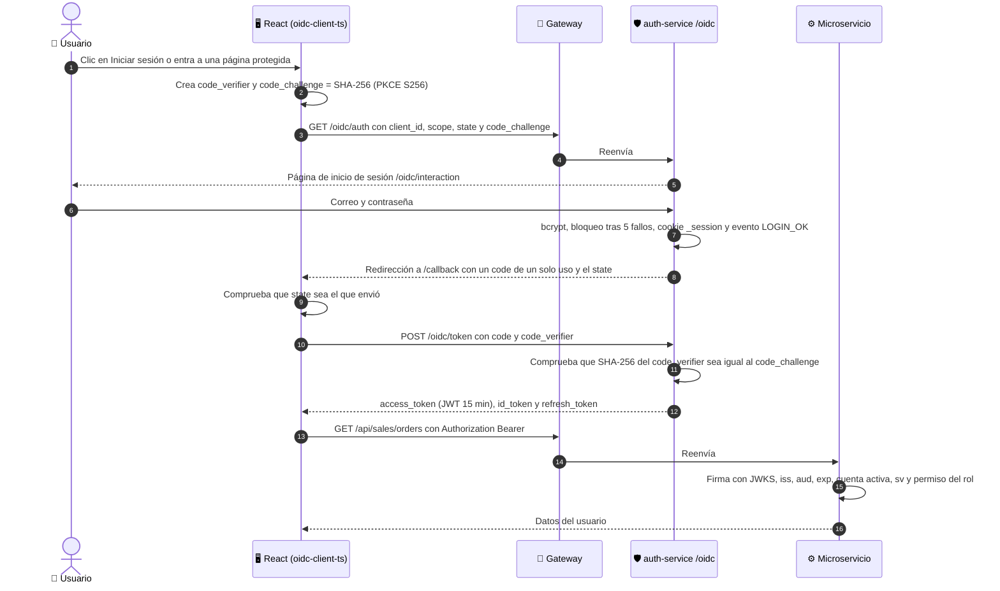

# 🏗️ Arquitectura web de Exclusive


> 🖼️ Versión en imagen PNG (alta resolución) para presentaciones: [img/arquitectura-web.png](img/arquitectura-web.png)

---

## 🧭 Resumen

**Exclusive** es una tienda en línea de ropa con su panel administrativo. Está construida con:

- 🖥️ **Frontend:** una aplicación **React 19** de una sola página (SPA), compilada con **Vite**.
- 🚪 **API Gateway:** un servidor **Express 5** que es el **único punto de entrada** (puerto 4000).
- ⚙️ **5 microservicios Node.js + Express**, cada uno dueño de un área del negocio.
- 🔐 **Seguridad con OAuth 2.0 + OpenID Connect**: inicio de sesión con *Authorization Code + PKCE* y tokens **JWT** firmados.
- 🗄️ **PostgreSQL** como base de datos, accedida mediante el ORM **Prisma**.
- 🤖 **TensorFlow.js** para estimar las ventas de la siguiente semana.

El navegador **nunca** habla directamente con los microservicios: todo pasa por el gateway. Los microservicios
escuchan solo en `127.0.0.1`, así que no son accesibles desde otros equipos de la red.

---

## 🧱 Capas del sistema

| # | Capa | Qué contiene | Tecnología |
|:-:|---|---|---|
| 1️⃣ | 🖥️ **Usuarios y aplicación web** | Tienda pública y panel administrativo en el navegador | React 19, Vite, React Router, Framer Motion, Chart.js, oidc-client-ts |
| 2️⃣ | 🚪 **API Gateway** | Seguridad HTTP, límite de solicitudes, enrutamiento, documentación y frontend | Express 5, Helmet, http-proxy-middleware, Swagger UI |
| 3️⃣ | ⚙️ **Microservicios** | Autenticación, catálogo, inventario, ventas y analítica | Node.js 20.19+ (recomendado 22), Express 5, oidc-provider, sharp, pdfkit, TensorFlow.js |
| 4️⃣ | 🗄️ **Datos** | Base de datos, imágenes, comprobantes, registros y respaldos | PostgreSQL 14+, sistema de archivos |
| 5️⃣ | 🔐 **Seguridad** | Cómo OAuth 2.0 y OpenID Connect protegen todas las capas anteriores | oidc-provider, oidc-client-ts, jose, bcrypt |
| 6️⃣ | 🤖 **Inteligencia artificial** | Predicción de las ventas de la próxima semana por categoría | TensorFlow.js |

---

## 1️⃣ 🖥️ Usuarios y aplicación web (React)

La aplicación vive en `frontend/` y tiene dos grandes áreas:

| Área | Rutas | Para quién |
|---|---|---|
| 🛍️ **Tienda pública** | `/` · `/tienda` · `/tienda/:categoria` · `/producto/:slug` · `/carrito` · `/checkout` · `/registro` · `/recuperar` · `/ayuda` · `/politicas/:slug` · `/buzon` | Cualquier visitante (el checkout pide iniciar sesión) |
| 👤 **Mi cuenta** | `/cuenta/pedidos` · `/cuenta/pedidos/:codigo` · `/cuenta/posventa` · `/cuenta/direcciones` · `/cuenta/notificaciones` · `/cuenta/perfil` | Cliente con sesión |
| 🧑‍💼 **Panel administrativo** | `/admin/*`: resumen, pedidos, pagos, envíos, posventa, productos, categorías, promociones, existencias, kardex, compras, proveedores, reportes, predicción de ventas, usuarios, roles, auditoría, configuración y estado del sistema | Personal según su rol |

### 📂 Organización del código

| Carpeta | Contenido |
|---|---|
| `src/api/` | Cliente HTTP: agrega el token, maneja errores y la llave de idempotencia |
| `src/auth/` | Sesión OpenID Connect y protección de rutas |
| `src/components/` | Componentes reutilizables (botones, tablas, tarjetas de indicadores, diseño de la tienda) |
| `src/lib/` | Formato de quetzales y fechas, alertas, gráficas, etiquetas de estados |
| `src/pages/store/` · `account/` · `admin/` | Pantallas de la tienda, de la cuenta y del panel |
| `src/store/` | Carrito (el de invitado se guarda en el navegador y se une a la cuenta al iniciar sesión) |
| `src/styles/` | Diseño propio con CSS: fondo blanco, verde jade y rojo granate |

### 🔄 Cómo se comunica con el servidor

1. Todas las llamadas usan `fetch` hacia rutas `/api/...` del **mismo origen** (el gateway).
2. Si hay sesión, se agrega el encabezado `Authorization: Bearer <access_token>`.
3. Las operaciones que no deben repetirse (confirmar compra, pagar, mover inventario) envían `Idempotency-Key`.
4. Los errores llegan como `{ error: { code, message, details }, requestId }` y se muestran con alertas claras.

### 🔑 Sesión

- Librerías **oidc-client-ts** y **react-oidc-context**.
- Flujo **Authorization Code + PKCE** con el cliente público `exclusive-web` (sin secretos en el navegador).
- Tokens guardados en `sessionStorage` (se borran al cerrar la pestaña) y renovación automática con *refresh token*.

### ✨ Experiencia de usuario

- **Framer Motion:** transiciones entre páginas, cajón del carrito y animaciones de confirmación.
- **Sonner:** notificaciones breves ("Agregado al carrito").
- **SweetAlert2:** confirmaciones importantes ("¿Cancelar pedido?").
- **Chart.js:** gráficas del panel, reportes y predicción.
- Fuente **Archivo** incluida en el proyecto: la demostración no depende de internet.

---

## 2️⃣ 🚪 API Gateway

Servidor en `services/gateway/`, puerto **4000**. Es lo único que se abre a la red.

| Responsabilidad | Detalle |
|---|---|
| 🛡️ Cabeceras de seguridad | Helmet; en producción, una política de contenido (CSP) que solo permite recursos del propio sitio |
| 🚦 Límite de solicitudes | Máximo configurable por equipo (`API_RATE_LIMIT`) |
| 🧾 Trazabilidad | Asigna un `x-request-id` a cada solicitud y lo propaga a los servicios |
| 🔀 Enrutamiento | Reenvía cada ruta al microservicio correspondiente (tabla de abajo) |
| ❤️ Salud | `GET /api/health`: estado de cada servicio y de su conexión a PostgreSQL |
| 📘 Documentación | `GET /api/docs`: OpenAPI con Swagger UI |
| 🖥️ Frontend | `npm start`: entrega `frontend/dist`. `npm run dev`: reenvía al servidor de Vite (puerto 5173) |

### 🔀 Tabla de enrutamiento

| Ruta | Microservicio |
|---|---|
| `/oidc/*` · `/api/auth/*` | 🛡️ auth-service (4001) |
| `/api/catalog/*` · `/uploads/*` | 👕 catalog-service (4002) |
| `/api/inventory/*` | 📦 inventory-service (4003) |
| `/api/sales/*` | 🛒 sales-service (4004) |
| `/api/analytics/*` | 📊 analytics-service (4005) |

---

## 3️⃣ ⚙️ Microservicios

Todos se crean con la misma base (`createService`): identificador de solicitud, registro técnico, `/health`, validación
de JSON y manejo de errores con identificador.

### 🛡️ auth-service · puerto 4001

| | |
|---|---|
| **Responsabilidad** | Identidad y acceso: proveedor OAuth 2.0 / OpenID Connect, cuentas, roles y permisos |
| **Funciones** | Inicio de sesión con bcrypt · bloqueo tras 5 intentos fallidos · límite de intentos · tokens JWT RS256 de 15 min · refresh token rotativo · registro · recuperación de contraseña (enlace de un solo uso, 30 min) · perfil · direcciones · notificaciones · buzón de pruebas · eventos de seguridad · tokens para servicios (*client credentials*) |
| **Rutas** | `/oidc/*` (proveedor) · `/api/auth/*` (cuenta) · `/api/auth/admin/*` (usuarios y roles) · `/api/auth/mailbox` |
| **Tablas** | users · roles · permissions · role_permissions · user_roles · addresses · password_resets · oidc_payloads · notifications · mailbox_messages · security_events |

### 👕 catalog-service · puerto 4002

| | |
|---|---|
| **Responsabilidad** | Todo lo que se muestra en la tienda |
| **Funciones** | Catálogo público con búsqueda, filtros (categoría, talla, color, precio, ofertas) y paginación · productos y variantes talla × color con SKU único · carga de imágenes (validación por firma del archivo, mínimo 300 px, conversión a WebP con sharp) · categorías, colores, tallas y guía de tallas · datos de la tienda · políticas con versiones |
| **Rutas** | `/api/catalog/*` (público) · `/api/catalog/admin/*` · `/uploads/products/*` (imágenes) |
| **Tablas** | products · product_variants · product_images · categories · colors · sizes · size_guides · store_settings · policies |

### 📦 inventory-service · puerto 4003

| | |
|---|---|
| **Responsabilidad** | Existencias y su trazabilidad |
| **Funciones** | Existencia física, reservada y disponible por variante · reservas con actualización atómica (la última unidad solo se reserva una vez) · kardex inmutable con saldos antes y después · correcciones con movimientos inversos · compras a proveedores · alertas de existencia mínima |
| **Rutas** | `/api/inventory/*` (personal) · `/internal/*` (solo otros servicios con token de servicio) |
| **Tablas** | inventory_stock · inventory_movements · reservations · purchases · purchase_items · suppliers |

### 🛒 sales-service · puerto 4004

| | |
|---|---|
| **Responsabilidad** | Proceso de venta completo |
| **Funciones** | Carrito persistente · cotización calculada en el servidor · checkout idempotente · pedidos con estados separados de pedido, pago y envío · pagos simulados con tarjeta, transferencia o contra entrega · comprobantes de transferencia privados · comprobantes de venta en PDF ("sin validez fiscal") · transportistas, guías y seguimiento · cambios, devoluciones y reclamos · reembolsos con tope · promociones y cupones · cancelación automática de reservas vencidas (cada minuto) |
| **Rutas** | `/api/sales/*` (cliente) · `/api/sales/admin/*` (personal) |
| **Tablas** | carts · cart_items · orders · order_items · order_status_history · payments · refunds · sale_documents · shipments · shipment_events · carriers · shipping_zones · post_sale_requests · post_sale_items · post_sale_history · promotions · coupons · coupon_redemptions |

### 📊 analytics-service · puerto 4005

| | |
|---|---|
| **Responsabilidad** | Información para decidir |
| **Funciones** | Panel con indicadores y comparación contra el período anterior · reportes de ventas, productos, dimensiones (categoría, talla, color, departamento), descuentos, devoluciones e inventario · exportación CSV · consulta de la bitácora de auditoría y de errores técnicos · historial semanal por categoría · predicción de ventas |
| **Rutas** | `/api/analytics/*` · `/api/analytics/ai/*` |
| **Tablas** | sales_weekly_history · ml_models · ml_forecasts · error_logs · audit_logs (todos los servicios escriben ahí; analytics la consulta) |

---

## 🔗 Comunicación entre servicios

| Tipo | Cómo funciona |
|---|---|
| 👤 **Usuario → servicio** | El gateway reenvía la solicitud con el token del usuario. El servicio valida firma, emisor, audiencia y vigencia del JWT con las **llaves públicas (JWKS)** del auth-service, y revisa en la base que la cuenta siga activa, la versión de sesión y los permisos del rol |
| ⚙️ **Servicio → servicio** | El sales-service pide al auth-service un token *client credentials* (`svc-sales`) con audiencia interna y llama a `POST /internal/reservations` del inventory-service para **reservar, confirmar, liberar o despachar** existencias |
| 🧠 **Proceso hijo** | El analytics-service ejecuta el entrenamiento de IA en un proceso aparte (`child_process.fork`), así no bloquea la atención de compras |

---

## 🛒 Flujo de una compra (saga con compensación)



Después: el **pago** (tarjeta simulada, comprobante de transferencia revisado por Ventas o cobro contra entrega)
confirma el pedido. El **despacho** convierte la reserva en salida de inventario una sola vez. Si el pago no llega a
tiempo, un trabajo programado **cancela el pedido y libera** las existencias.

---

## 📦 Código compartido entre servicios

| Paquete | Qué aporta |
|---|---|
| 🧰 `@exclusive/common` | `authenticate()` y `requirePermission()` · catálogo de roles y permisos · auditoría · manejo de errores con `errorId` · logger que oculta contraseñas y tokens · dinero en centavos con redondeo comercial · motor de precios y cupones · máquinas de estado · validación con zod · cliente entre servicios · notificaciones y correos de prueba |
| 🗃️ `@exclusive/db` | **Prisma ORM** con un solo esquema (`packages/db/prisma/schema.prisma`) y el adaptador nativo `pg`; los 5 servicios comparten el mismo cliente |

---

## 4️⃣ 🗄️ Datos

### 🐘 PostgreSQL

| Base | Uso |
|---|---|
| `exclusive_db` | Demostración: **49 tablas del negocio** + vista `v_stock` + control de migraciones de Prisma |
| `exclusive_test` | Pruebas automatizadas (`npm test`), independiente de la demostración |

**Propiedad lógica:** todos los servicios usan la misma base, pero cada tabla tiene un **servicio dueño** que es el
único que la modifica. Si un servicio necesita cambiar datos de otro, lo pide por API.

**Protecciones dentro de la base de datos:**
- 🔒 **Triggers:** `audit_logs` (bitácora) e `inventory_movements` (kardex) son de **solo inserción**; no se pueden editar ni borrar.
- ✅ **CHECK:** lo reservado nunca supera lo físico; los montos no pueden ser negativos.
- 🔑 **Únicos:** SKU, códigos de pedido y llaves de idempotencia, para que un reintento no duplique registros.

### 📁 Archivos

| Carpeta | Contenido | Acceso |
|---|---|---|
| `services/catalog-service/uploads/products` | Imágenes de productos y categorías (WebP) | 🌐 Público |
| `services/sales-service/storage/receipts` | Comprobantes de transferencia | 🔒 Solo el dueño o personal autorizado |
| `logs/` | Registro técnico de cada servicio (JSON por línea, sin datos sensibles) | 🧑‍💻 Administración |
| `backups/` | Respaldos con `npm run backup` (base + imágenes + comprobantes, verificados con SHA-256) | 🧑‍💻 Administración |

---

## 5️⃣ 🔐 Seguridad: OAuth 2.0 + OpenID Connect

| Estándar | Qué hace en Exclusive | Qué entrega |
|---|---|---|
| 🔑 **OAuth 2.0** | Autoriza al frontend a usar la API en nombre de la persona | `access_token` y `refresh_token` |
| 🪪 **OpenID Connect** | Capa sobre OAuth 2.0 que identifica a la persona que inició sesión | `id_token`, documento de descubrimiento y llaves públicas (JWKS) |

El **proveedor** es el auth-service, publicado en `/oidc` con la librería `oidc-provider`. Su emisor (`iss`) es
`http://localhost:4000/oidc` y su configuración pública está en `/oidc/.well-known/openid-configuration`.

### 🔄 Inicio de sesión paso a paso (Authorization Code + PKCE)



Antes de todo esto, al abrir la tienda, React intenta un **inicio silencioso** (`prompt=none` en un iframe oculto con
`/silent-renew.html`): si ya hay una sesión abierta en el proveedor entra sin pedir la contraseña; si no, la persona
navega como visitante. Por eso la tienda es pública y solo pide iniciar sesión al pagar, en "Mi cuenta" o en el panel.

### 🎟️ Los tres tokens

| Token | Estándar | Formato y duración | Para quién (`aud`) | Qué contiene | Para qué se usa |
|---|---|---|---|---|---|
| 🔑 `access_token` | OAuth 2.0 | JWT firmado RS256 · 15 minutos | `urn:exclusive:api` | `sub` (id del usuario), `email`, `roles`, `sv` (versión de sesión), `scope: api` | Va en cada llamada: `Authorization: Bearer …` |
| 🪪 `id_token` | OpenID Connect | JWT firmado RS256 · 1 hora | `exclusive-web` | `name`, `given_name`, `family_name`, `email`, `email_verified`, `roles` | Saber quién entró y cerrar sesión (`id_token_hint`). Nunca va a la API |
| 🔁 `refresh_token` | OAuth 2.0 | Opaco · hasta 8 horas · rotativo | El proveedor | Nada legible: se guarda en `oidc_payloads` | Renovar los tokens sin pedir la contraseña; el anterior responde `invalid_grant` |

`oidc-client-ts` renueva los tokens solo, un minuto antes de que venzan, con `grant_type=refresh_token`. Los tokens
se guardan en `sessionStorage`, así que se borran al cerrar la pestaña.

### 📋 Clientes registrados

| Cliente | Tipo | Flujos | Detalle |
|---|---|---|---|
| 🖥️ `exclusive-web` | Público, sin secreto | `authorization_code` + `refresh_token` | PKCE S256 obligatorio · redirecciones `/callback` y `/silent-renew.html`; al salir `/` y `/sesion-cerrada` |
| 🤖 `svc-auth`, `svc-catalog`, `svc-inventory`, `svc-sales`, `svc-analytics` | Confidenciales, con secreto del `.env` | `client_credentials` | Token JWT de 10 minutos con `aud: urn:exclusive:internal` para las rutas `/internal/*` |

### ✅ Autorización en cada microservicio

`authenticate()` y `requirePermission()` de `@exclusive/common` hacen estas revisiones en orden:

| # | Revisión | Si falla |
|:-:|---|---|
| 1 | ¿Trae `Authorization: Bearer`? | `401 LOGIN_REQUIRED` |
| 2 | Firma RS256 con el JWKS del proveedor (en caché 10 min), `iss`, `aud` y `exp` | `401 INVALID_TOKEN` o `TOKEN_EXPIRED` |
| 3 | La cuenta está `ACTIVO` y el `sv` del token es igual a `session_version` en la base (caché 10 s) | `401 ACCOUNT_DISABLED` o `SESSION_REVOKED` |
| 4 | El rol tiene el permiso pedido (`role_permissions` en la base) | `403 FORBIDDEN` y evento `PERMISSION_DENIED` en `security_events` |
| ✅ | Ejecuta la operación; los datos del cliente se filtran por `customerId = sub` | |

Los permisos no viajan en el token: se leen de la base, así que un cambio de permisos aplica en segundos.

### 🚪 Cierre de sesión y revocación

- **Cerrar sesión:** React borra sus tokens y abre `/oidc/session/end` con `id_token_hint`; el proveedor termina su
  sesión y regresa a la tienda.
- **Cerrar sesión en todos los dispositivos**, **cambiar o restablecer la contraseña**, **desactivar la cuenta** o
  **Cerrar sesiones** desde el panel llaman a `revokeAllSessions()`: `session_version` sube en 1 y se borran las
  sesiones y refresh tokens del usuario en `oidc_payloads`.
- Un token ya emitido deja de servir aunque no haya vencido: al instante en el auth-service y en máximo 10 segundos
  en los demás servicios.

### 🌐 Endpoints del proveedor

| Ruta | Uso |
|---|---|
| `/oidc/.well-known/openid-configuration` | Descubrimiento |
| `/oidc/auth` | Autorización |
| `/oidc/interaction/:uid` | Página propia de inicio de sesión |
| `/oidc/token` | Tokens, renovación y tokens de servicio |
| `/oidc/jwks` | Llave pública para verificar firmas |
| `/oidc/me` | Datos del usuario (*userinfo*) |
| `/oidc/session/end` | Cerrar sesión |
| `/oidc/token/revocation` | Revocar un token |

### 🛡️ Protecciones

- 🔒 PKCE S256 obligatorio: un `code` robado no sirve sin el `code_verifier`.
- 🧩 `state` contra respuestas falsas y `redirect_uri` registradas exactas.
- 🔑 La contraseña solo se escribe en la página del proveedor; React nunca la ve.
- ⏱️ 20 intentos por equipo cada 15 minutos y bloqueo de la cuenta 15 minutos tras 5 fallos.
- 🍪 Cookies del proveedor `HttpOnly`, firmadas y `SameSite=Lax`.
- 🗝️ Llave privada en `services/auth-service/keys/jwks.json`, fuera de GitHub.
- 🧱 Audiencias separadas: un token de usuario no sirve en `/internal` y uno de servicio no sirve en la API pública.

Explicación completa con tokens reales decodificados y respuestas de error: [oauth-openid.md](oauth-openid.md).

---

## 6️⃣ 🤖 Inteligencia artificial

1. **Historial semanal:** suma por categoría las unidades vendidas cada semana (lunes a domingo), restando devoluciones y sin contar cancelaciones.
2. **Entrenamiento** en un proceso aparte con **TensorFlow.js**: un conjunto de 5 redes neuronales pequeñas, que usan las 4 semanas anteriores, la época del año, la tendencia y la categoría.
3. **Evaluación honesta:** se prueba con las últimas 8 semanas que el modelo no vio y se compara su error (MAE) contra el promedio simple.
4. **Versiones:** cada entrenamiento queda guardado con su período, variables, métricas y fecha; la pantalla **Predicción de ventas** muestra la estimación de la siguiente semana.

La IA solo informa: no hace compras ni ajustes de inventario.

---

## 🌐 Ejecución y puertos

| Puerto | Componente | Visible en la red |
|---|---|:-:|
| **4000** | 🚪 API Gateway (tienda, panel y API) | ✅ |
| 4001 | 🛡️ auth-service | ❌ |
| 4002 | 👕 catalog-service | ❌ |
| 4003 | 📦 inventory-service | ❌ |
| 4004 | 🛒 sales-service | ❌ |
| 4005 | 📊 analytics-service | ❌ |
| 5173 | ⚡ Vite (solo con `npm run dev`) | ❌ |
| 5432 | 🐘 PostgreSQL | ❌ |

| Modo | Comando | Qué hace |
|---|---|---|
| 🛠️ Desarrollo | `npm run dev` | Inicia los 6 procesos con recarga automática y el servidor de Vite |
| 🚀 Producción | `npm run build` y `npm start` | Compila el frontend y el gateway lo entrega directamente |

Para usarlo desde otros dispositivos de la misma red se cambia `PUBLIC_URL` en `.env` por la IP del equipo
(por ejemplo `http://192.168.1.50:4000`).

---

## 📁 Estructura del repositorio

```
EXCLUSIVE_TIENDA_ONLINE/
├── 🗄️ database/            Script SQL para importar, estructura de pruebas y generador de datos
├── 📘 docs/                Documentación, OpenAPI y este diagrama
├── 🖥️ frontend/            Aplicación React (tienda y panel)
├── 📦 packages/
│   ├── common/             Seguridad, auditoría y reglas de negocio compartidas
│   └── db/                 Esquema Prisma y cliente ORM
├── 🧰 scripts/             Verificación, respaldos, pruebas y rendimiento
├── ⚙️ services/
│   ├── gateway/
│   ├── auth-service/
│   ├── catalog-service/
│   ├── inventory-service/
│   ├── sales-service/
│   └── analytics-service/
└── 🧪 tests/
    ├── unit/               Reglas sin base de datos
    └── integration/        Reglas críticas contra la base de pruebas
```

---

## ✅ Observabilidad y calidad

| Aspecto | Cómo se cubre |
|---|---|
| ❤️ Salud | `/health` en cada servicio, `/api/health` en el gateway y pantalla **Estado del sistema** |
| 🧾 Trazabilidad | `x-request-id` en cada solicitud · historial de estados de pedidos · kardex · bitácora de auditoría |
| 🐞 Errores | Mensajes claros al usuario y un identificador para encontrar el detalle técnico en **Auditoría → Errores técnicos** |
| 🧪 Pruebas | `npm test`: pruebas unitarias y de integración con node:test sobre la base `exclusive_test` |
| 📈 Rendimiento | `npm run perf`: 20 usuarios concurrentes sobre el catálogo |
| 💾 Respaldos | `npm run backup` y `npm run restore` con verificación automática |
| 📘 API | Especificación OpenAPI en `docs/openapi.yaml`, visible en `/api/docs` |
