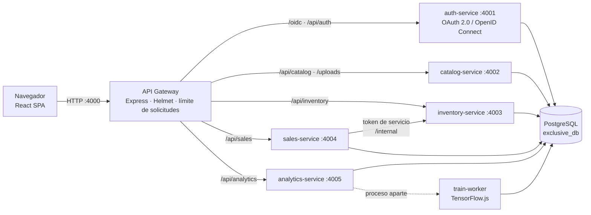
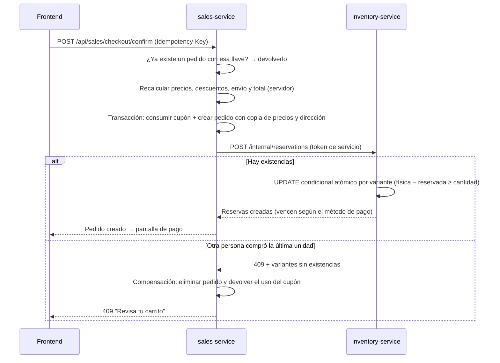

# Arquitectura de Exclusive

Exclusive es una tienda en línea de ropa (Guatemala, quetzales, español) con su panel de administración.
Se construyó como **microservicios Node.js** detrás de un **API Gateway**, con un frontend **React** y una
base de datos **PostgreSQL** accedida mediante el ORM **Prisma**.

> **Nota sobre el documento de definición.** La sección 8 del documento proponía un monolito modular.
> Por decisión del equipo, el sistema se implementó con microservicios para separar responsabilidades
> (seguridad, catálogo, inventario, ventas y analítica), aislar las tareas pesadas (RNF-25) y permitir
> que cada módulo evolucione sin afectar a los demás. Se conservan todas las demás tecnologías
> (Node.js, Express, PostgreSQL, Prisma, node:test, TensorFlow.js, Chart.js, OpenAPI). El diseño visual
> usa CSS3 propio con componentes React en lugar de Bootstrap.

## Vista general



- El navegador **solo** se comunica con el gateway (puerto 4000). Los microservicios escuchan en `127.0.0.1`,
  por lo que no son accesibles desde otros equipos de la red.
- En producción (`npm start`) el gateway también entrega el frontend compilado (`frontend/dist`).
  En desarrollo (`npm run dev`) reenvía las páginas al servidor de Vite (puerto 5173) con recarga automática.
- Cada servicio expone `GET /health` (estado y conexión a PostgreSQL). El gateway los agrupa en `GET /api/health`
  y el panel los muestra en **Sistema → Estado del sistema** (RNF-26).

## Microservicios y responsabilidades

| Servicio | Puerto | Responsabilidad | Tablas que administra |
|---|---|---|---|
| **gateway** | 4000 | Punto de entrada único, cabeceras de seguridad (Helmet/CSP), límite de solicitudes, enrutamiento, documentación OpenAPI (`/api/docs`), entrega del frontend | — |
| **auth-service** | 4001 | Proveedor OAuth 2.0 / OpenID Connect, inicio de sesión, registro, recuperación de acceso, perfil, direcciones, notificaciones, usuarios, roles y permisos, buzón de pruebas, eventos de seguridad | users, roles, permissions, role_permissions, user_roles, addresses, password_resets, oidc_payloads, notifications, mailbox_messages, security_events |
| **catalog-service** | 4002 | Catálogo público, productos, variantes (SKU), imágenes, categorías, colores, tallas, guías de tallas, configuración de la tienda y políticas versionadas | products, product_variants, product_images, categories, colors, sizes, size_guides, store_settings, policies |
| **inventory-service** | 4003 | Existencias físicas/reservadas/disponibles, reservas, kardex inmutable, compras a proveedores, proveedores, alertas de mínimos | inventory_stock, inventory_movements, reservations, purchases, purchase_items, suppliers |
| **sales-service** | 4004 | Carrito, cotización, checkout, pedidos y estados, pagos simulados, comprobantes de transferencia, documentos de venta (PDF), envíos, posventa, reembolsos, promociones y cupones, cobertura y tarifas | carts, cart_items, orders, order_items, order_status_history, payments, refunds, sale_documents, shipments, shipment_events, carriers, shipping_zones, post_sale_*, promotions, coupons, coupon_redemptions |
| **analytics-service** | 4005 | Panel e indicadores, reportes y exportaciones CSV, bitácora de auditoría y errores técnicos, historial semanal y modelo de IA | sales_weekly_history, ml_models, ml_forecasts, audit_logs (lectura), error_logs |

**Base de datos compartida con propiedad lógica.** Todos los servicios usan la misma base `exclusive_db` (un solo
esquema Prisma en `packages/db/prisma/schema.prisma`), pero cada tabla tiene un servicio dueño que es el único que la
modifica. Cuando un servicio necesita cambiar datos de otro, lo pide por API: por ejemplo, el sales-service
**no** toca existencias; solicita al inventory-service reservar, confirmar, liberar o despachar mediante
`/internal/reservations/*`. Esta decisión mantiene las transacciones locales de PostgreSQL (RNF-07) sin la
complejidad de bases separadas en una instalación académica de una sola computadora.

## Comunicación entre servicios

- **Usuario → servicio:** el frontend envía `Authorization: Bearer <access_token>` (JWT RS256). Cada servicio
  valida firma (JWKS del auth-service), emisor, audiencia `urn:exclusive:api`, vigencia y el estado actual del
  usuario (cuenta activa y `sessionVersion`), y lee sus permisos de la base de datos.
- **Servicio → servicio:** cada servicio obtiene un token *client credentials* (`svc-sales`, `svc-inventory`…)
  con audiencia interna `urn:exclusive:internal` y alcance `internal`. Las rutas `/internal/*` rechazan cualquier
  otro token. El usuario que originó la acción viaja en cabeceras para la auditoría.

## Confirmación de compra (saga con compensación)



Un trabajo programado en el sales-service cancela los pedidos cuyo plazo de pago venció y libera sus reservas
(regla 2). Despachar convierte la reserva en salida física **una sola vez** (regla 3).

## Seguridad en capas

1. **Gateway:** Helmet (`X-Content-Type-Options`, `Referrer-Policy`, `X-Frame-Options`; en `npm start` además una CSP estricta que solo permite recursos del propio sitio), límite general de solicitudes.
2. **OIDC:** Authorization Code + PKCE obligatorio, tokens de acceso de 15 minutos, refresh tokens rotativos, cierre de sesión.
3. **Servicios:** validación de cada token, permisos por rol desde la base, propiedad de los datos (un cliente solo ve lo suyo).
4. **Base de datos:** CHECKs (reservado ≤ físico, montos no negativos), triggers que impiden editar o borrar la bitácora y el kardex.

Detalle en [seguridad.md](seguridad.md).

## Inteligencia artificial

El entrenamiento corre en un **proceso hijo** (`child_process.fork`) del analytics-service, por lo que nunca
bloquea la atención de compras (RNF-25). Detalle en [inteligencia-artificial.md](inteligencia-artificial.md).

## Estructura del repositorio

```
exclusive/
├─ database/
│  ├─ exclusive_db.sql        ← script para importar (estructura + datos de demostración)
│  ├─ schema.sql              ← solo estructura (base de pruebas e instalación limpia)
│  └─ generator/              ← generador del historial de demostración
├─ docs/                      ← esta documentación y openapi.yaml
├─ frontend/                  ← React 19 + Vite (tienda y panel)
├─ packages/
│  ├─ common/                 ← configuración, seguridad, auditoría, dinero, precios, estados, errores
│  └─ db/                     ← esquema Prisma compartido y cliente ORM
├─ scripts/                   ← verificación, respaldos, pruebas, rendimiento
├─ services/
│  ├─ gateway/  auth-service/  catalog-service/  inventory-service/  sales-service/  analytics-service/
└─ tests/
   ├─ unit/                   ← reglas puras (sin base de datos)
   └─ integration/            ← reglas críticas contra la base de PRUEBAS
```

## Ambientes (RNF-27)

| Ambiente | Configuración | Base de datos | Uso |
|---|---|---|---|
| Desarrollo / demostración | `.env` | `exclusive_db` | `npm run dev` o `npm start` |
| Pruebas | `.env.test` (se crea con `npm run test:db`) | `exclusive_test` | `npm test` |
| Producción futura | variables del servidor (`NODE_ENV=production`) | propia, con HTTPS | ver [seguridad.md](seguridad.md#despliegue-comercial-rnf-06) |

Los archivos `.env` y `.env.test` están en `.gitignore`: las credenciales nunca se suben al repositorio.
