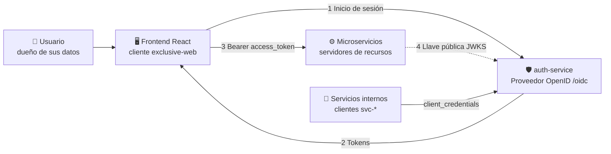
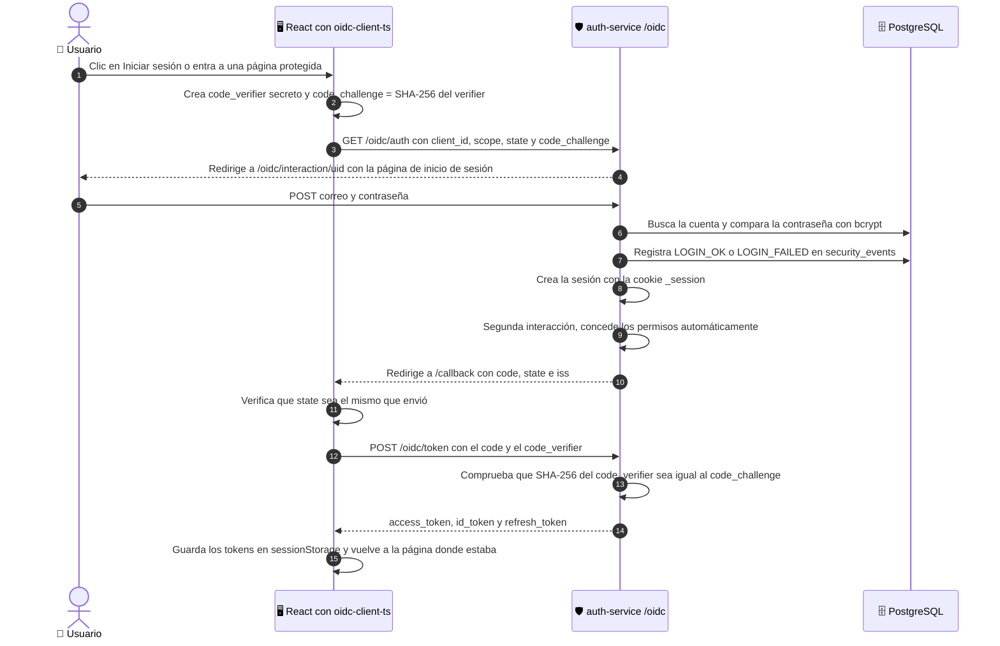
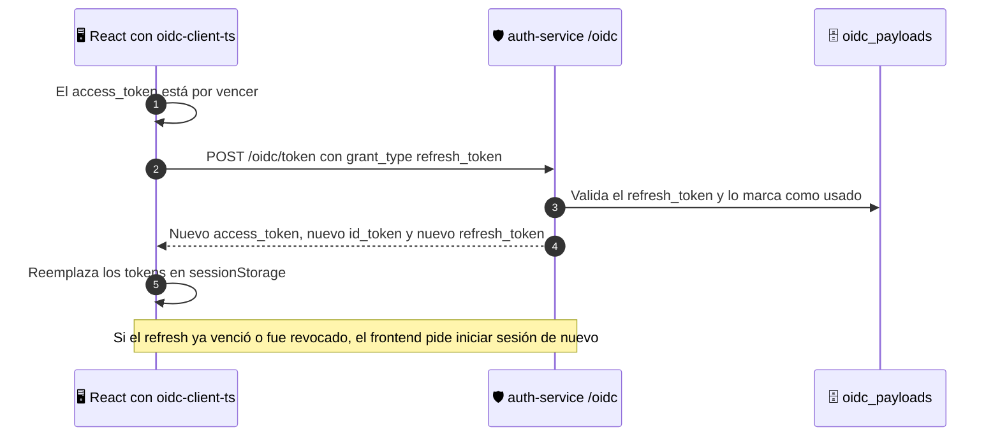
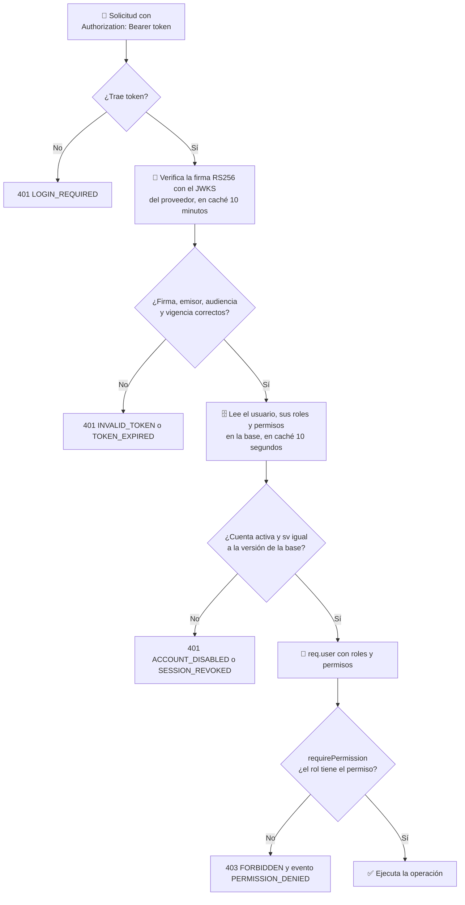
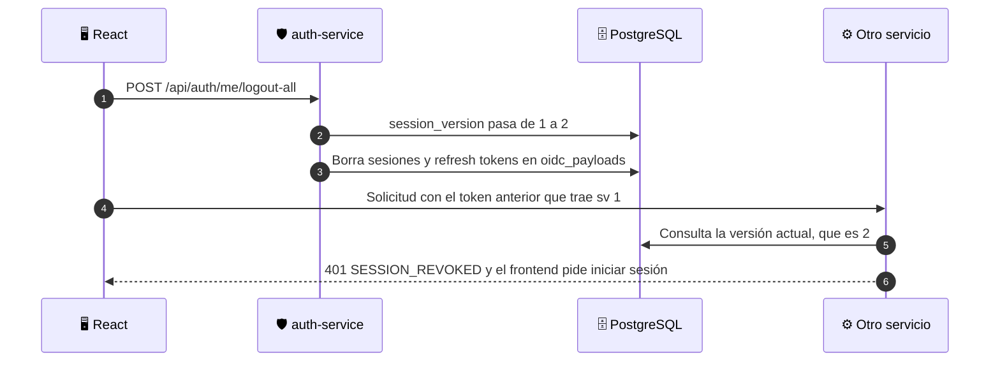
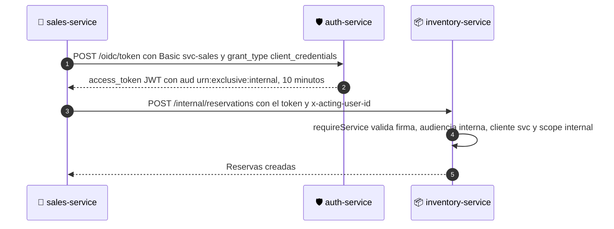

# 🔐 OAuth 2.0 y OpenID Connect en Exclusive

Este documento explica cómo el sistema identifica a las personas (**autenticación**) y cómo decide qué puede hacer
cada una (**autorización**) usando los estándares **OAuth 2.0** y **OpenID Connect (OIDC)**.

> En una línea: el **auth-service** es el proveedor de identidad; el **frontend** obtiene tokens con
> *Authorization Code + PKCE*; cada **microservicio** valida esos tokens con la llave pública del proveedor y revisa
> en la base de datos los permisos del rol.

Todos los ejemplos de este documento (URLs, tokens decodificados, respuestas y códigos de error) se tomaron del
sistema funcionando con el usuario de prueba `cliente@exclusive.gt`.

---

## 🧠 1. Conceptos

| Estándar | Para qué sirve | Qué entrega |
|---|---|---|
| 🔑 **OAuth 2.0** | **Autorizar** a una aplicación a usar una API en nombre de alguien | `access_token` para llamar a la API y `refresh_token` para renovarlo |
| 🪪 **OpenID Connect** | Capa sobre OAuth 2.0 para **identificar** a la persona | `id_token` con los datos de quien inició sesión, el documento de descubrimiento y las llaves públicas (JWKS) |

OAuth 2.0 responde **"¿qué puede hacer esta aplicación?"** y OpenID Connect responde **"¿quién es esta persona?"**.
Exclusive usa los dos.

### 👥 Los actores en Exclusive



| Rol del estándar | En Exclusive |
|---|---|
| **Dueño del recurso** | La persona: cliente de la tienda o personal |
| **Cliente** | `exclusive-web` (el frontend React) y `svc-auth`, `svc-catalog`, `svc-inventory`, `svc-sales`, `svc-analytics` (los servicios) |
| **Servidor de autorización / Proveedor OpenID** | **auth-service**, publicado en `http://localhost:4000/oidc` con la librería certificada `oidc-provider` |
| **Servidores de recursos** | Las API de auth, catalog, inventory, sales y analytics |

---

## 🗺️ 2. El proveedor OpenID (auth-service)

El proveedor publica su configuración en el **documento de descubrimiento**:
`http://localhost:4000/oidc/.well-known/openid-configuration`. El frontend lo lee al iniciar sesión para saber a
dónde enviar cada solicitud.

| Endpoint | Ruta | Uso |
|---|---|---|
| Autorización | `/oidc/auth` | Inicia el inicio de sesión |
| Token | `/oidc/token` | Cambia el código por tokens, renueva tokens y emite tokens de servicio |
| Llaves públicas (JWKS) | `/oidc/jwks` | Llave para verificar la firma de los tokens |
| Datos del usuario | `/oidc/me` | *Userinfo* de OpenID Connect |
| Cierre de sesión | `/oidc/session/end` | Cierra la sesión en el proveedor (*RP-Initiated Logout*) |
| Revocación | `/oidc/token/revocation` | Invalida un token |
| Interacción | `/oidc/interaction/:uid` | Página propia de inicio de sesión de Exclusive |

### ⚙️ Configuración principal

Archivo: `services/auth-service/src/oidc/provider.js`

| Parámetro | Valor |
|---|---|
| Emisor (`iss`) | `PUBLIC_URL` + `/oidc` → `http://localhost:4000/oidc` |
| PKCE | **Obligatorio**, solo método `S256` |
| Firma de tokens | **RS256** (llave RSA de 2048 bits) |
| Código de autorización | 60 segundos y un solo uso |
| `access_token` | JWT, **15 minutos** (`ACCESS_TOKEN_TTL=900`) |
| `id_token` | 1 hora |
| `refresh_token` | Opaco y **rotativo**, hasta 8 horas (`REFRESH_TOKEN_TTL`) |
| Sesión en el proveedor | 8 horas (`SESSION_TTL`) |
| Token de servicio | JWT, 10 minutos |
| Audiencias (*resource indicators*) | `urn:exclusive:api` para el frontend y `urn:exclusive:internal` para los servicios |
| Almacenamiento | Tabla `oidc_payloads` (sesiones, códigos, permisos concedidos y refresh tokens), con limpieza de vencidos |
| Llaves | `services/auth-service/keys/jwks.json`, se generan solas en el primer arranque y no se suben a GitHub |
| Cookies del proveedor | `_session` y `_interaction`, firmadas con `COOKIE_SECRET`, `HttpOnly` y `SameSite=Lax` |
| Páginas de desarrollo de la librería | Desactivadas: la página de inicio de sesión es propia |
| Introspección | Desactivada: los servicios validan el JWT por su cuenta con la llave pública |

### 📋 Clientes registrados

| Cliente | Tipo | Flujos permitidos | Cómo se autentica el cliente | Direcciones permitidas |
|---|---|---|---|---|
| 🖥️ `exclusive-web` | Público (aplicación de navegador) | `authorization_code` y `refresh_token` | Sin secreto: lo protege **PKCE** | `/callback` y `/silent-renew.html`; al cerrar sesión `/` y `/sesion-cerrada` |
| 🤖 `svc-auth`, `svc-catalog`, `svc-inventory`, `svc-sales`, `svc-analytics` | Confidencial (servidor) | `client_credentials` | Id y secreto (`SVC_SECRET_*` del `.env`) en el encabezado `Authorization: Basic` | No aplica |

Las direcciones se arman con `PUBLIC_URL` y `EXTRA_ORIGINS`. Cualquier otra dirección se rechaza con una página de
error y no se emite ningún código.

---

## 🔄 3. Inicio de sesión: Authorization Code + PKCE

### 🧩 Paso a paso



### 🔎 Cómo se ve en el navegador (F12 → pestaña Network)

Registro real de un inicio de sesión, en orden:

```
GET  /oidc/.well-known/openid-configuration
GET  /oidc/auth?client_id=exclusive-web&redirect_uri=http://localhost:4000/silent-renew.html&response_type=code
          &scope=openid+profile+email+api&state=beb3a3…&code_challenge=_fIj3Y…&code_challenge_method=S256&prompt=none
GET  /oidc/auth?client_id=exclusive-web&redirect_uri=http://localhost:4000/callback&response_type=code
          &scope=openid+profile+email+api&state=619785…&code_challenge=A-PTn-…&code_challenge_method=S256
GET  /oidc/interaction/8w1GKJ…                 página de inicio de sesión
POST /oidc/interaction/8w1GKJ…/login           correo y contraseña
GET  /oidc/auth/8w1GKJ…                        el proveedor continúa
GET  /oidc/interaction/Te6S7P…                 consentimiento (se aprueba solo)
GET  /oidc/auth/Te6S7P…
GET  /callback?code=d03_rv…&state=619785…&iss=http://localhost:4000/oidc
POST /oidc/token   grant_type=authorization_code&redirect_uri=…/callback&code=d03_rv…
                   &code_verifier=(96 caracteres)&client_id=exclusive-web
GET  /api/auth/me                              primera llamada a la API con el token
```

La primera solicitud con `prompt=none` es el **inicio silencioso**: al abrir la tienda, el frontend pregunta en un
iframe oculto (`/silent-renew.html`) si ya hay una sesión abierta en el proveedor. Si la hay, entra sin pedir la
contraseña; si no, sigue como visitante. Por eso la tienda es **pública** y solo pide iniciar sesión al pagar o
al entrar a "Mi cuenta" o al panel.

### 🛡️ Por qué este flujo es seguro

| Riesgo | Protección | Resultado comprobado |
|---|---|---|
| Alguien roba el `code` de la URL | Sin el `code_verifier`, que nunca sale del navegador, no puede cambiarlo por tokens (**PKCE**) | `invalid_grant` |
| Una aplicación intenta iniciar sesión sin PKCE | El proveedor lo exige siempre | `error=invalid_request` "Authorization Server policy requires PKCE" |
| Redirección a un sitio malicioso | Solo se aceptan las direcciones registradas | Página de error, sin código |
| Respuesta falsa inyectada en `/callback` | El frontend compara el `state` que envió con el que regresa | Se descarta |
| Robo de contraseña desde el frontend | La contraseña se escribe en la página del **proveedor**, no en React | React nunca la ve |
| Adivinar contraseñas | 20 intentos por equipo cada 15 minutos, bloqueo de la cuenta 15 minutos tras 5 fallos y el mismo mensaje de error para todo | Eventos `LOGIN_FAILED`, `ACCOUNT_LOCKED` y `RATE_LIMIT` |
| Saber si un correo existe midiendo el tiempo de respuesta | Si el correo no existe se compara contra un hash falso para tardar lo mismo | Respuesta idéntica |
| Secretos en el navegador | `exclusive-web` es un cliente público: no tiene secreto que robar | No aplica |
| Cookies robadas con JavaScript | `HttpOnly`, firmadas y `SameSite=Lax` | Inaccesibles desde JS |

---

## 🎟️ 4. Los tokens

La respuesta de `POST /oidc/token` trae tres tokens:

```json
{
  "access_token": "eyJhbGciOiJSUzI1NiIsInR5cCI6ImF0K2p3dCIs…",
  "expires_in": 900,
  "id_token": "eyJhbGciOiJSUzI1NiIsImtpZCI6…",
  "refresh_token": "J4H8uB… (43 caracteres)",
  "scope": "api",
  "token_type": "Bearer"
}
```

### 🔑 `access_token`: para llamar a la API (OAuth 2.0)

Es un **JWT firmado con RS256**. Encabezado y contenido decodificados:

```json
{ "alg": "RS256", "typ": "at+jwt", "kid": "0a849b4d-b802-44e2-9d89-3e720cc3b17e" }
```

```json
{
  "iss": "http://localhost:4000/oidc",
  "sub": "6",
  "aud": "urn:exclusive:api",
  "client_id": "exclusive-web",
  "scope": "api",
  "iat": 1793079491,
  "exp": 1793080391,
  "jti": "eftSwq3GSK8ZyeA8UALrp3cnanmYZkNg6MYkcqFPSvs",
  "email": "cliente@exclusive.gt",
  "roles": ["CLIENTE"],
  "sv": 1
}
```

| Campo | Significado |
|---|---|
| `kid` | Cuál llave del JWKS firmó el token |
| `iss` | Quién lo emitió: el proveedor de Exclusive |
| `sub` | Id del usuario en la tabla `users` |
| `aud` | Para quién es: la API de Exclusive |
| `iat` / `exp` | Cuándo se emitió y cuándo vence (900 segundos después) |
| `jti` | Identificador único del token |
| `roles` | Roles del usuario al momento de emitirlo (informativo) |
| `sv` | **Versión de sesión**: si cambia en la base de datos, el token deja de servir (sección 7) |

El frontend envía este token en cada llamada: `Authorization: Bearer eyJhbGciOi…`

### 🪪 `id_token`: quién inició sesión (OpenID Connect)

```json
{
  "iss": "http://localhost:4000/oidc",
  "sub": "6",
  "aud": "exclusive-web",
  "name": "María José López",
  "given_name": "María José",
  "family_name": "López",
  "email": "cliente@exclusive.gt",
  "email_verified": true,
  "roles": ["CLIENTE"],
  "iat": 1793079491,
  "exp": 1793083091
}
```

Su audiencia es el propio frontend (`aud: exclusive-web`), no la API. El frontend lo usa para saber quién entró y
como `id_token_hint` al cerrar sesión. **Nunca** se envía a los microservicios: para eso está el `access_token`.

### 🔁 `refresh_token`: renovar sin volver a escribir la contraseña

- Es **opaco** (no es un JWT): solo el proveedor sabe qué significa, porque está guardado en `oidc_payloads`.
- Es **rotativo**: cada renovación entrega uno nuevo y el anterior deja de servir. Si alguien intenta usar uno viejo,
  el proveedor responde `400 invalid_grant`.

### 🧾 Scopes y claims

| Scope solicitado | Qué agrega |
|---|---|
| `openid` | Activa OpenID Connect: emite `id_token` con `sub` |
| `profile` | `name`, `given_name`, `family_name` y `roles` |
| `email` | `email` y `email_verified` |
| `api` | Permiso para la API de Exclusive: el `access_token` sale con `aud: urn:exclusive:api` |

---

## ♻️ 5. Renovación automática de la sesión



Solicitud real: `POST /oidc/token  grant_type=refresh_token&refresh_token=…&scope=api&client_id=exclusive-web`

- `oidc-client-ts` renueva solo cuando falta un minuto para que venza el token (`automaticSilentRenew`).
- Como respaldo, antes de cada llamada a la API se revisa el token y, si le quedan menos de 30 segundos, se renueva
  primero (`getToken` en `frontend/src/auth/session.jsx`).
- Así la persona puede trabajar hasta 8 horas sin volver a escribir su contraseña, aunque cada `access_token` dure
  solo 15 minutos.

---

## ✅ 6. Autorización: cómo cada microservicio valida el token

Cada solicitud protegida pasa por `authenticate()` de `packages/common/src/auth.js`, que usan todos los servicios:



Respuestas reales:

| Caso | Respuesta |
|---|---|
| Sin token | `401 {"error":{"code":"LOGIN_REQUIRED","message":"Inicia sesión para continuar."}}` |
| Token inventado | `401 {"error":{"code":"INVALID_TOKEN","message":"El token de acceso no es válido."}}` |
| Cliente pidiendo la lista de usuarios | `403 {"error":{"code":"FORBIDDEN","message":"No tienes permiso para realizar esta acción."}}` |
| Después de cerrar todas las sesiones | `401 {"error":{"code":"SESSION_REVOKED","message":"Tu sesión fue cerrada. Inicia sesión de nuevo."}}` |

Cada 401 incluye el encabezado `WWW-Authenticate: Bearer error="invalid_token"`, como indica el estándar.

Ejemplo de una ruta protegida por permiso (sales-service):

```js
r.post('/payments/:id/review', requirePermission('payments.review'), async (req, res) => {
```

Y las rutas del cliente filtran por el dueño del dato, así nadie ve pedidos ajenos aunque cambie el código en la URL:

```js
const o = await prisma.order.findFirst({ where: { code: String(code), customerId: req.user.id }, include: fullOrderInclude });
```

### 🎭 Roles y permisos

Los permisos **no** van dentro del token: cada servicio los lee de la base (`roles`, `permissions`,
`role_permissions` y `user_roles`). Si el administrador cambia los permisos de un rol en **Roles y permisos**, el
cambio aplica en segundos, sin esperar a que venzan los tokens.

| Rol | Ejemplos de permisos |
|---|---|
| 👑 ADMIN | Los 26 permisos |
| 🧾 VENTAS | `orders.manage`, `payments.review`, `shipping.manage` |
| 📦 INVENTARIO | `catalog.manage`, `inventory.move`, `suppliers.manage` |
| 🎧 ATENCION | `postsale.manage`, `refunds.create` |
| 📈 GERENCIA | `reports.read`, `reports.export`, `ai.train`, `audit.read` |
| 🛍️ CLIENTE | Ningún permiso administrativo: solo su carrito, sus pedidos y su perfil |

El frontend también oculta los menús y muestra "No tienes acceso a esta sección" según los permisos, pero eso es solo
comodidad: **quien decide es siempre el backend**.

---

## 🚪 7. Cierre de sesión y revocación

| Acción | Qué pasa |
|---|---|
| **Cerrar sesión** | El frontend borra los tokens de `sessionStorage` y abre `/oidc/session/end?client_id=exclusive-web&post_logout_redirect_uri=…&id_token_hint=…`. El proveedor termina su sesión (cookie `_session`) y regresa a la tienda |
| **Cerrar sesión en todos los dispositivos** (Mi cuenta → Perfil y seguridad) | Sube la versión de sesión (`session_version`) y borra todas las sesiones y refresh tokens del usuario en `oidc_payloads` |
| **Cambiar o restablecer la contraseña** | Igual que el anterior |
| **Desactivar una cuenta** o **Cerrar sesiones** (panel → Usuarios) | Igual que el anterior; además, el proveedor no emite tokens para cuentas inactivas |

Las cuatro acciones usan la misma función `revokeAllSessions()` de `services/auth-service/src/routes/account.js`.



¿Qué pasa con un token que ya estaba emitido? Aunque le queden minutos de vida, deja de servir: en el auth-service
de inmediato y en los demás servicios en un máximo de **10 segundos**, que es lo que dura la caché del estado del
usuario. Medido en el sistema: el auth-service respondió `401 SESSION_REVOKED` al instante y el sales-service a los
9 segundos. El refresh token tampoco sirve más (`400 invalid_grant`), así que no se puede obtener un token nuevo.

---

## 🤖 8. Comunicación entre servicios: Client Credentials

Cuando el sales-service necesita reservar existencias en el inventory-service no reenvía el token del usuario: pide
un **token propio** al proveedor.



Contenido real de un token de servicio:

```json
{
  "iss": "http://localhost:4000/oidc",
  "sub": "svc-sales",
  "client_id": "svc-sales",
  "aud": "urn:exclusive:internal",
  "scope": "internal",
  "iat": 1793079575,
  "exp": 1793080175,
  "jti": "H6tggZEYCxYnHFAFY7acqTdOWl9JbgtznnLbIXB_uFG"
}
```

- El token se guarda en memoria y se reutiliza hasta 30 segundos antes de vencer
  (`packages/common/src/serviceClient.js`). Si un servicio responde 401, se descarta y se pide otro.
- Quién originó la acción viaja en `x-acting-user-id` y `x-acting-user-email`, para que la **auditoría** registre a
  la persona y no al servicio. El `x-request-id` permite seguir la misma operación en los registros de todos los
  servicios.
- Las audiencias separan los dos mundos: un token de usuario no sirve en `/internal` y un token de servicio no sirve
  en la API pública, porque la verificación exige la audiencia correcta.

| Prueba | Respuesta real |
|---|---|
| `/internal/...` desde afuera, por el gateway | `404` (el gateway no publica esas rutas) |
| `/internal/reservations` directo al servicio sin token | `401 SERVICE_TOKEN_REQUIRED` |
| Pedir token de servicio con un secreto incorrecto | `401 invalid_client` |

---

## 🗃️ 9. Dónde se guarda cada cosa

| Dato | Dónde |
|---|---|
| Tokens del usuario en el navegador | `sessionStorage`, clave `oidc.user:http://localhost:4000/oidc:exclusive-web` (se borran al cerrar la pestaña) |
| Sesión del proveedor | Cookies `_session` y `_session.sig` (firmadas, `HttpOnly`) y la tabla `oidc_payloads` |
| Códigos, permisos concedidos y refresh tokens | Tabla `oidc_payloads` |
| Llave privada de firma | `services/auth-service/keys/jwks.json` (no se sube a GitHub) |
| Contraseñas | Tabla `users`, solo el hash bcrypt |
| Enlaces de recuperación de contraseña | Tabla `password_resets`, solo el hash SHA-256 del enlace, válido 30 minutos |
| Inicios de sesión, bloqueos y accesos denegados | Tabla `security_events` |
| Secretos de los servicios y de las cookies | Archivo `.env` (no se sube a GitHub) |

---

## 🧪 10. Cómo comprobarlo en vivo

1. Con el sistema iniciado, abre `http://localhost:4000/oidc/.well-known/openid-configuration` y muestra los
   endpoints, `"code_challenge_methods_supported": ["S256"]` y `"id_token_signing_alg_values_supported": ["RS256"]`.
2. Abre `http://localhost:4000/oidc/jwks`: aparece solo la **llave pública** (`kty`, `n`, `e`, `kid`), nunca la privada.
3. Presiona **F12**, entra a la pestaña **Network** (Red) y marca **Preserve log**. Inicia sesión con
   `cliente@exclusive.gt` / `Cliente123!`: verás `/oidc/auth` con `code_challenge`, la página de interacción,
   `/callback?code=…` y el `POST /oidc/token`.
4. En F12 entra a **Application** (Aplicación) → **Session Storage** → `http://localhost:4000` y abre la clave
   `oidc.user:…`: ahí están los tres tokens.
5. Copia el `access_token`, pégalo en [jwt.io](https://jwt.io) y muestra `iss`, `sub`, `aud`, `exp`, `roles` y `sv`.
6. Abre `http://localhost:4000/api/docs`, presiona **Authorize**, pega el token y prueba `GET /api/auth/me` (200) y
   `GET /api/auth/admin/users` (403, porque el cliente no tiene `users.read`).
7. Entra como `admin@exclusive.gt` / `Admin123!` → **Auditoría** → pestaña **Eventos de seguridad**: aparecen el
   inicio de sesión del cliente y el acceso denegado del paso 6.
8. Prueba la revocación: con el cliente, en **Mi cuenta → Perfil y seguridad** presiona **Cerrar sesión en todos los
   dispositivos**. Repite en Swagger `GET /api/auth/me` con el token anterior: responde `401 SESSION_REVOKED`.

Las pruebas automáticas de `tests/integration/authorization.test.js` comprueban esto mismo en cada `npm test`:
solicitudes sin token, tokens con firma desconocida o vencidos, pedidos y comprobantes ajenos, acciones
administrativas sin permiso, sesiones cerradas en todos los dispositivos y cuentas desactivadas.

---

## 📁 11. Archivos involucrados

| Archivo | Qué hace |
|---|---|
| `services/auth-service/src/oidc/provider.js` | Configuración del proveedor: clientes, PKCE, duración de tokens, audiencias y cierre de sesión |
| `services/auth-service/src/oidc/interactions.js` | Página de inicio de sesión, bcrypt, bloqueo, límite de intentos y consentimiento automático |
| `services/auth-service/src/oidc/adapter.js` | Guarda sesiones, códigos y tokens del proveedor en PostgreSQL con Prisma |
| `services/auth-service/src/oidc/keys.js` | Genera y carga la llave RS256 |
| `services/auth-service/src/oidc/views.js` | Páginas HTML de inicio de sesión, cierre de sesión y errores |
| `services/auth-service/src/routes/account.js` | Registro, recuperación de contraseña, perfil y `revokeAllSessions()` |
| `services/auth-service/src/routes/admin.js` | Usuarios, roles, desactivación y cierre de sesiones desde el panel |
| `packages/common/src/auth.js` | `authenticate()`, `requirePermission()` y `requireService()` para todos los servicios |
| `packages/common/src/serviceClient.js` | Pide y reutiliza el token *client credentials* entre servicios |
| `packages/common/src/permissions.js` | Catálogo de los 26 permisos y los 6 roles |
| `frontend/src/auth/session.jsx` | Configuración OIDC del frontend, inicio silencioso, renovación y cierre de sesión |
| `frontend/src/auth/guards.jsx` | Protege las páginas que requieren sesión o permisos |
| `frontend/public/silent-renew.html` | Página del iframe oculto para el inicio silencioso |
| `tests/integration/authorization.test.js` | Pruebas automáticas de autenticación y autorización |
