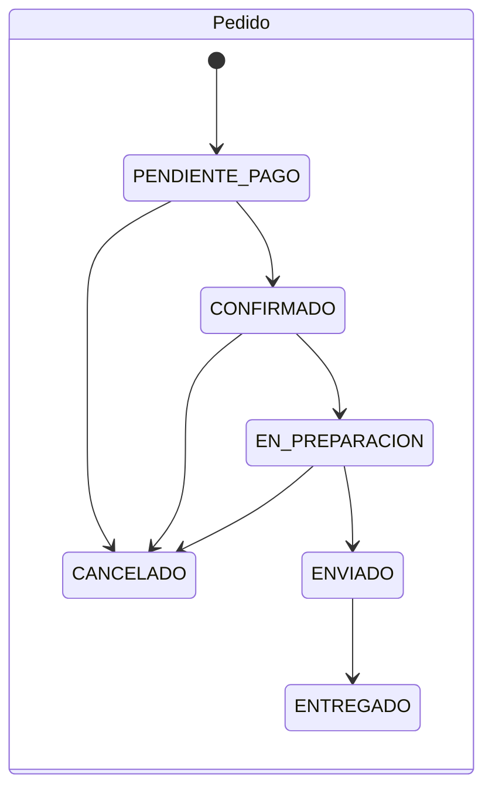

# Reglas de negocio y cálculos

Este documento explica cómo el sistema aplica las 15 reglas de negocio de la definición del proyecto,
las reglas de cálculo de dinero y promociones, y los estados de pedidos, pagos, envíos y posventa.

## Las 15 reglas de negocio

| # | Regla | Cómo se cumple | Evidencia |
|---|---|---|---|
| 1 | No confirmar cantidades superiores a las disponibles | La reserva hace un `UPDATE` condicional atómico (físico − reservado ≥ cantidad). Un `CHECK` en la base impide reservado > físico. El carrito avisa de cantidades no disponibles antes de pagar | `inventory.test.js` |
| 2 | Reservas con vencimiento configurable; el carrito no reserva | La reserva se crea al **confirmar** la compra: 30 min para tarjeta y 48 h para transferencia (configurables en **Configuración → Comercio**). Contra entrega no vence. Un trabajo programado cancela los pedidos vencidos y libera existencias | `inventory.test.js` |
| 3 | El despacho reduce existencia física y elimina la reserva, sin duplicar | `dispatchOrder` convierte cada reserva en un movimiento `SALIDA_VENTA` con llave `DESPACHO:<pedido>:<variante>`; repetirlo no genera otra salida | `inventory.test.js` |
| 4 | Precios, descuentos y totales validados por el backend | El frontend envía solo variantes y cantidades; `buildQuote` + `calculateQuote` recalculan todo en el servidor | `pricing.test.js` |
| 5 | Un comprobante de transferencia no confirma el pago | Al subirlo, el pago queda **En revisión** hasta que Ventas lo aprueba o rechaza en **Pagos** | E2E de la demostración |
| 6 | Los reintentos no duplican pedidos, movimientos, pagos ni reembolsos | Llaves de idempotencia únicas en pedidos, pagos, movimientos, compras y reembolsos | `inventory.test.js`, `sales.test.js` |
| 7 | Cambios de estado según transiciones y permisos | Máquinas de estado en `packages/common/src/stateMachines.js` + permisos por ruta | `state-machines.test.js`, `authorization.test.js` |
| 8 | Productos con historial se desactivan en lugar de borrarse | Si el producto tiene ventas o movimientos de inventario, el sistema rechaza el borrado y pide **desactivarlo o archivarlo**; solo se borra si no tiene historial | Catálogo → Productos |
| 9 | Movimientos corregidos con nuevos movimientos | El kardex es de solo inserción (trigger); **Corregir** crea un movimiento inverso que referencia al original | `audit.test.js` |
| 10 | Promociones sin totales negativos y con reglas de combinación | Ningún descuento supera el saldo de la línea; cupones combinables o no combinables | `pricing.test.js` |
| 11 | Los pedidos conservan sus condiciones originales | `order_items` guarda nombre, SKU, talla, color, precio, descuento y promoción; el pedido guarda la dirección, el detalle de promociones y la versión de los términos aceptados | Detalle del pedido |
| 12 | Devoluciones físicas y reembolsos se registran por separado | Posventa: **Recibir prendas** (condición y reintegro al inventario) es un paso distinto de **Resolver** (reembolso) | Posventa |
| 13 | Los reembolsos no superan lo pagado | `createRefund` compara el acumulado reembolsado contra `amount_paid` dentro de la transacción | `sales.test.js` |
| 14 | La IA apoya decisiones y no ejecuta compras ni ajustes | El módulo de IA solo lee el historial y guarda estimaciones; no tiene permisos sobre inventario ni compras | `inteligencia-artificial.md` |
| 15 | Datos ficticios y simulaciones distinguibles | Pedidos, pagos y reembolsos tienen `is_simulation = true`; los comprobantes en PDF dicen "SIMULACIÓN — SIN VALIDEZ FISCAL"; la tienda muestra el aviso "Entorno académico (simulado)"; los clientes ficticios usan el dominio `@demo.exclusive.gt` | Interfaz y base de datos |

## Dinero (RNF-10)

- **Representación:** en la base, columnas `DECIMAL(12,2)` en quetzales; en el código, **centavos enteros**
  (`packages/common/src/money.js`). Nunca se hacen cálculos con números de punto flotante.
- **Redondeo:** *mitad hacia arriba* (redondeo comercial) **al centavo y por línea**. Ejemplo: 12.5 % de Q 123.45
  = 15.43125 → Q 15.43; 10 % de Q 0.05 = 0.005 → Q 0.01.
- **Repartos:** cuando un descuento fijo se reparte entre varias líneas se usa el método del mayor residuo: la suma
  de las partes es exactamente el descuento.
- **Total del pedido** = Σ (precio × cantidad − descuento de la línea) + envío − descuento de envío; nunca menor que cero.
- Contra entrega solo está disponible para compras de hasta Q 3,000.00.

## Promociones y cupones (RF-10, HU-06, HU-14)

| Tipo | Alcance | Efecto |
|---|---|---|
| `PORCENTAJE` | Todo, categoría o producto | % sobre el subtotal de la línea (con tope opcional) |
| `MONTO_FIJO` | Categoría o producto | Monto por unidad |
| `MONTO_FIJO` | Todo | Monto al pedido, repartido entre las líneas |
| `ENVIO_GRATIS` | Todo | Descuenta el costo de envío (con compra mínima opcional) |

Orden de aplicación:

1. **Promociones automáticas** (sin cupón): en cada línea se aplica **la mejor** promoción aplicable; dos
   promociones automáticas nunca se acumulan en la misma línea.
2. **Cupón:** si es *combinable* se aplica sobre el saldo de cada línea después de las automáticas; si **no** es
   combinable, solo se aplica a las líneas sin otra promoción.
3. **Envío:** se calcula con la tarifa del departamento; el envío gratis automático o por cupón lo descuenta.

Validaciones del cupón: existe y está activo, vigencia, compra mínima, límite total de usos y límite por cliente.
El uso se consume dentro de la misma transacción que crea el pedido y se devuelve si el pedido se cancela.

Cupones de demostración: `BIENVENIDA10` (10 %, una vez por cliente), `EXCLUSIVE50` (Q 50 desde Q 400),
`ENVIOGRATIS` (envío gratis) y `VERANO2026` (vencido, para probar el rechazo).

## Estados (RF-21)

El pedido, el pago y el envío tienen **estados separados**, cada uno con su historial.

| Máquina | Transiciones permitidas |
|---|---|
| **Pago** | PENDIENTE → EN_REVISION, APROBADO, RECHAZADO · EN_REVISION → APROBADO, RECHAZADO · RECHAZADO → PENDIENTE, EN_REVISION, APROBADO (reintento) · APROBADO → REEMBOLSO_PARCIAL, REEMBOLSADO · REEMBOLSO_PARCIAL → REEMBOLSO_PARCIAL, REEMBOLSADO |
| **Envío** | PENDIENTE → PREPARANDO → DESPACHADO → EN_TRANSITO → ENTREGADO; DESPACHADO o EN_TRANSITO → INCIDENCIA; INCIDENCIA → EN_TRANSITO, ENTREGADO, DEVUELTO |
| **Posventa** | SOLICITADA → EN_REVISION, APROBADA, RECHAZADA · EN_REVISION → APROBADA, RECHAZADA · APROBADA → PRENDA_RECIBIDA, RESUELTA · PRENDA_RECIBIDA → RESUELTA · RESUELTA/RECHAZADA → CERRADA |

Reglas cruzadas:

- Solo se despacha un pedido **en preparación** y con pago **aprobado** (salvo contra entrega).
- El cliente puede cancelar mientras el pedido esté *pendiente de pago* o *confirmado*; al cancelar se liberan las
  reservas, se devuelve el uso del cupón y se registra el reembolso simulado de lo pagado.

## Pagos simulados (RF-19, RF-20, HU-08)

| Método | Funcionamiento |
|---|---|
| Tarjeta | Número validado con Luhn; `4242 4242 4242 4242` aprobado, `4000 0000 0000 0002` rechazado (se puede reintentar), `4000 0000 0000 9995` pendiente. Solo se guarda la marca y los últimos 4 dígitos |
| Transferencia | El cliente sube su comprobante; queda **En revisión** hasta la decisión de Ventas |
| Contra entrega | El pedido se confirma de inmediato y el cobro se registra al marcar la entrega |

Al aprobarse un pago se emite un **comprobante de venta de demostración** (PDF) marcado como
"SIMULACIÓN — SIN VALIDEZ FISCAL".

## Inventario (RF-13 a RF-18)

- **Físico:** unidades en bodega. **Reservado:** apartado por pedidos confirmados aún no despachados.
  **Disponible** = físico − reservado (es lo que ve la tienda).
- Tipos de movimiento: inventario inicial, entrada por compra, entrada por devolución, ajuste de entrada,
  salida por venta, salida por cambio, devolución a proveedor, daño, pérdida y ajuste de salida.
- Cada movimiento guarda cantidad, saldos antes/después (físico y reservado), motivo, responsable, referencia
  (pedido, compra, posventa) y documento.
- No se puede retirar mercadería que respalda reservas de pedidos.
- Cada variante tiene una **existencia mínima**; al cruzarla se notifica al personal de inventario.

## Posventa (RF-24 a RF-26, HU-10, HU-17)

1. El cliente solicita **cambio**, **devolución** o **reclamo** desde el detalle del pedido entregado (plazo
   configurable, 30 días por defecto).
2. Atención al cliente revisa y aprueba o rechaza.
3. Al recibir las prendas registra su condición; las que están en buen estado se **reintegran** al inventario
   (movimiento `ENTRADA_DEVOLUCION`).
4. La resolución registra el **reembolso simulado** (con tope en lo pagado) o la salida de la prenda de cambio.

El formulario de reclamos indica que no sustituye los medios autorizados por la DIACO.
