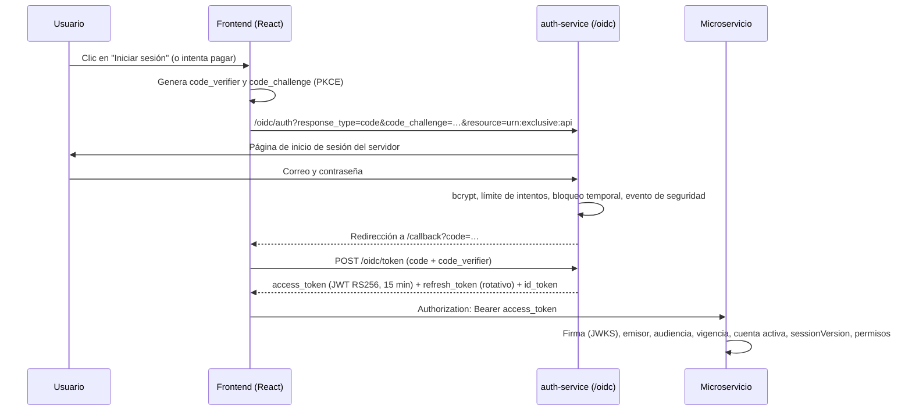

# Seguridad

Resumen de los controles de seguridad de Exclusive y de cómo se verifican.

## Autenticación: OAuth 2.0 + OpenID Connect

El **auth-service** es un proveedor OpenID Connect certificado (biblioteca `oidc-provider`), publicado en
`/oidc`. Su configuración pública está en `http://localhost:4000/oidc/.well-known/openid-configuration`.

| Aspecto | Implementación |
|---|---|
| Flujo | Authorization Code con **PKCE obligatorio** (cliente público `exclusive-web`, sin secreto en el navegador) |
| Token de acceso | JWT firmado RS256, audiencia `urn:exclusive:api`, vigencia `ACCESS_TOKEN_TTL` (900 s) |
| Renovación | Refresh token **rotativo** (cada uso emite uno nuevo); la sesión vence a las 8 h |
| Llaves | Par RSA generado al primer arranque en `services/auth-service/keys/jwks.json` (fuera del repositorio) |
| Cierre de sesión | `end_session` de OIDC; "Cerrar sesión en todos los dispositivos" incrementa `sessionVersion` |
| Entre servicios | *Client credentials* por servicio (`svc-*`), audiencia `urn:exclusive:internal`, alcance `internal` |
| Almacenamiento en el navegador | `sessionStorage` (se borra al cerrar la pestaña); nada sensible en `localStorage` |

### Revocación de sesiones (RNF-03)

Cada token de acceso lleva el claim `sv` (versión de sesión del usuario). Los servicios comparan ese valor con el de
la base de datos en cada solicitud (caché de 10 segundos). Por eso **cerrar sesión en todos los dispositivos,
cambiar la contraseña, restablecerla o desactivar la cuenta** invalida inmediatamente los tokens ya emitidos.
Prueba: `tests/integration/authorization.test.js`.

### Protección del acceso (RNF-04)

- **Límite de intentos:** `LOGIN_RATE_LIMIT` intentos de inicio de sesión cada 15 minutos por equipo;
  `RESET_RATE_LIMIT` solicitudes de recuperación cada 15 minutos; registro limitado a 20 por hora.
- **Bloqueo temporal:** tras `MAX_FAILED_LOGINS` (5) contraseñas incorrectas, la cuenta se bloquea `LOCK_MINUTES` (15).
  El administrador puede desbloquearla desde **Usuarios**.
- **Sin revelar cuentas:** el mensaje de error es el mismo si el correo no existe, la contraseña es incorrecta o la
  cuenta está bloqueada; además se ejecuta una comparación bcrypt ficticia para que el tiempo de respuesta tampoco
  lo delate. La recuperación responde igual exista o no el correo.
- **Recuperación de acceso (HU-02):** el enlace llega al **buzón de pruebas**, vence en 30 minutos, se guarda solo
  su hash SHA-256 y se puede usar una sola vez (los anteriores quedan anulados).

## Contraseñas (RNF-02)

- Hash **bcrypt** (costo 10) con sal individual por usuario; nunca se guardan ni se registran en texto plano.
- Política: 8 a 72 caracteres, con mayúscula, minúscula y número (validada en el servidor).
- Los registros técnicos y la bitácora eliminan automáticamente campos como `password`, `passwordHash`, `token`,
  `authorization`, `cardNumber` y `cvv`.
- Prueba: `tests/unit/passwords.test.js` (incluye la verificación de que cada usuario del script SQL tiene su propia sal).

## Autorización (RNF-01)

Cada ruta protegida declara el permiso que necesita (`requirePermission('orders.manage')`). Los permisos se leen de la
base de datos, así que un cambio hecho por el administrador en **Roles y permisos** se aplica en segundos. Las rutas del
cliente filtran siempre por el usuario del token: un pedido ajeno responde como inexistente (404). Cada acceso
denegado genera un evento de seguridad `PERMISSION_DENIED`.

### Roles y permisos

| Permiso | ADMIN | VENTAS | INVENTARIO | ATENCION | GERENCIA | CLIENTE |
|---|:-:|:-:|:-:|:-:|:-:|:-:|
| dashboard.view — Ver el panel | ✔ | ✔ | ✔ | ✔ | ✔ | |
| users.read / users.manage — Usuarios | ✔ | | | | | |
| roles.manage — Roles y permisos | ✔ | | | | | |
| catalog.read — Consultar catálogo | ✔ | ✔ | ✔ | ✔ | ✔ | |
| catalog.manage — Productos, variantes, imágenes | ✔ | | ✔ | | | |
| inventory.read — Existencias y kardex | ✔ | ✔ | ✔ | | ✔ | |
| inventory.move — Entradas, salidas y ajustes | ✔ | | ✔ | | | |
| suppliers.manage — Proveedores y compras | ✔ | | ✔ | | | |
| promotions.manage — Promociones y cupones | ✔ | | | | | |
| orders.read — Consultar pedidos | ✔ | ✔ | | ✔ | ✔ | |
| orders.manage — Estados y cancelación | ✔ | ✔ | | | | |
| payments.review — Revisar transferencias | ✔ | ✔ | | | | |
| shipping.manage — Despachos y entregas | ✔ | ✔ | | | | |
| shipping.config — Cobertura y tarifas | ✔ | | | | | |
| postsale.read — Consultar posventa | ✔ | ✔ | | ✔ | ✔ | |
| postsale.manage — Gestionar posventa | ✔ | | | ✔ | | |
| refunds.create — Reembolsos simulados | ✔ | | | ✔ | | |
| reports.read — Reportes y gráficas | ✔ | ✔ | ✔ | | ✔ | |
| reports.export — Exportar CSV | ✔ | | ✔ | | ✔ | |
| ai.read — Estimaciones de IA | ✔ | | ✔ | | ✔ | |
| ai.train — Entrenar el modelo | ✔ | | | | ✔ | |
| audit.read — Bitácora y eventos | ✔ | | | | ✔ | |
| settings.manage — Configuración y políticas | ✔ | | | | | |
| system.health — Estado de servicios | ✔ | | | | | |
| mailbox.read — Buzón de pruebas en el panel | ✔ | | | ✔ | | |

El cliente solo accede a su propia información (pedidos, direcciones, notificaciones, comprobantes).

## Validación de entradas y archivos (RNF-05)

- Todos los cuerpos y parámetros se validan en el servidor con **zod** (mensajes por campo en español).
  El frontend nunca envía precios: solo variantes y cantidades; el total lo calcula el servidor (regla 4).
- Las consultas pasan por **Prisma** (consultas parametrizadas), sin concatenar SQL con datos del usuario.
- **Imágenes de productos:** se valida el tipo real por la firma del archivo (no por la extensión), máximo 5 MB,
  mínimo 300 × 300 px, y se **re-codifican a WebP** con `sharp`, lo que elimina metadatos y contenido incrustado.
- **Comprobantes de transferencia:** JPG, PNG, WebP o PDF de hasta 5 MB; los PDF con JavaScript, acciones de
  lanzamiento o archivos incrustados se rechazan; las imágenes se re-codifican. Se guardan **fuera** de la carpeta
  pública (`services/sales-service/storage`) y solo los puede abrir el dueño o personal autorizado.
- **Exportaciones CSV:** las celdas que empiezan con `=`, `+`, `-` o `@` se neutralizan (inyección CSV).
- **Solicitudes falsificadas (CSRF):** la API no usa cookies sino el encabezado `Authorization`, por lo que un sitio
  externo no puede hacer solicitudes autenticadas en nombre del usuario. Las cookies del proveedor OIDC son
  firmadas, `HttpOnly` y `SameSite=Lax`, y cada interacción de inicio de sesión tiene un identificador de un solo uso.

## Integridad, concurrencia e idempotencia (RNF-07, RNF-08, RNF-09)

- Las operaciones relacionadas se ejecutan en **transacciones** de PostgreSQL.
- **Última unidad:** la reserva usa un `UPDATE … WHERE físico − reservado ≥ cantidad` atómico; además un `CHECK`
  en la base impide que lo reservado supere lo físico.
- **Cupones:** el contador de usos se incrementa con una actualización condicional atómica y un bloqueo consultivo
  por cliente.
- **Idempotencia:** la confirmación de compra, los pagos con tarjeta, los movimientos de inventario, las compras y
  los reembolsos aceptan una llave `Idempotency-Key`; repetir la solicitud devuelve el mismo resultado.
- Pruebas: `tests/integration/inventory.test.js` y `tests/integration/sales.test.js`.

## Auditoría inmutable (RNF-15)

- Cada servicio registra en `audit_logs` las operaciones sensibles (usuarios, permisos, precios, promociones,
  inventario, pagos, pedidos, posventa, configuración) con usuario, fecha, IP, identificador de solicitud y valores
  antes/después.
- Un **trigger** de PostgreSQL (`exclusive_immutable_row`) rechaza cualquier `UPDATE` o `DELETE` sobre
  `audit_logs` e `inventory_movements`, aunque se intente desde fuera de la aplicación.
- El panel solo permite **consultar y filtrar** la bitácora (por usuario, fecha, acción, servicio y registro).
- Para operación comercial, `database/permisos-produccion.sql` crea un usuario de aplicación sin privilegios de
  superusuario y sin permiso de `UPDATE`, `DELETE` ni `TRUNCATE` sobre la bitácora, el kardex, los eventos de
  seguridad y los errores técnicos.

**Conservación:** la bitácora, el kardex y los eventos de seguridad no se depuran desde la aplicación. Se conservan
dentro de los respaldos diarios (ver [respaldos.md](respaldos.md)); en operación comercial se recomienda conservar al
menos 5 años los registros vinculados a ventas y pagos, y archivar (no borrar) los eventos de seguridad mayores a
1 año en una copia aparte.

## Privacidad y manejo de errores (RNF-16, RNF-17)

- Los clientes solo ven su información; los comprobantes se sirven con `Cache-Control: private, no-store`.
- Los mensajes de error al usuario nunca muestran consultas, credenciales ni trazas. Cada error inesperado devuelve
  un **identificador** (`errorId`) que el administrador puede buscar en **Auditoría → Errores técnicos**, donde se
  guarda el detalle técnico.
- Los registros técnicos (`logs/<servicio>.log`, JSON por línea) ocultan automáticamente datos sensibles.

## Despliegue comercial (RNF-06)

La demostración usa HTTP en la red local con datos ficticios. Antes de un despliegue real:

1. Publicar detrás de un proxy con **HTTPS** (por ejemplo Nginx o Caddy) y cambiar `PUBLIC_URL` a `https://…`.
2. Ejecutar con `NODE_ENV=production`, activar HSTS en el gateway y usar secretos largos y únicos en
   `COOKIE_SECRET` y `SVC_SECRET_*`.
3. Conectar la aplicación con el usuario restringido de `database/permisos-produccion.sql`.
4. Desactivar `MAILBOX_PUBLIC` y `DEMO_HINTS`, y sustituir pagos, facturación (FEL), correo y logística simulados
   por integraciones reales.
5. Programar respaldos diarios en otra ubicación (ver [respaldos.md](respaldos.md)).
